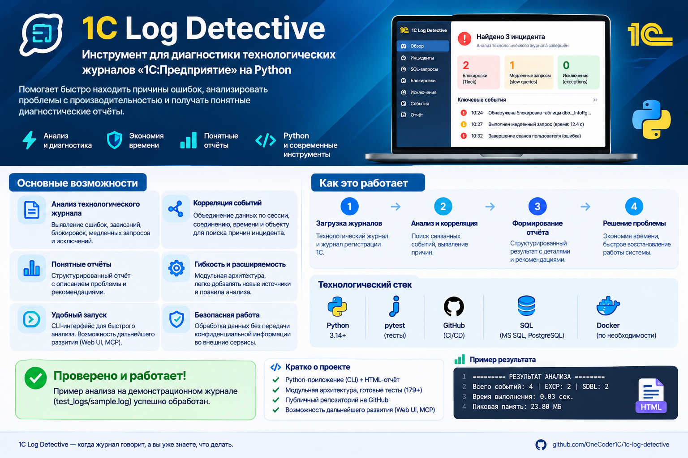

# 1C Log Detective



**1C Log Detective** — инструмент на Python для анализа технологических журналов 1С:Предприятие.

Он помогает разработчикам и специалистам сопровождения исследовать ошибки, блокировки, SQL-операции и проблемы производительности, находить связанные события и получать структурированные диагностические отчёты.

Проект ориентирован на работу с большими журналами: обработка выполняется потоково, а промежуточные результаты хранятся в SQLite.

## Возможности

### Анализ технологического журнала

- Потоковое чтение технологического журнала 1С.
- Разбор событий и извлечение временных отметок, типов событий, длительности и параметров.
- Обработка многострочных событий.
- Поддержка используемых проектом типов событий, включая EXCP, TLOCK, SDBL, SESN и DBV8DBEng.
- Обработка больших файлов без загрузки всего журнала в оперативную память.

### Анализ исключений EXCP

- Извлечение и группировка повторяющихся исключений.
- Подсчёт количества повторений.
- Определение времени первого и последнего появления.
- Выделение исключений, связанных с блокировками.
- Подготовка данных для дальнейшего расследования.

### Анализ блокировок TLOCK

- Разбор событий блокировок.
- Извлечение информации о потоках, ресурсах и областях блокировок.
- Анализ последовательностей событий.
- Исследование временной близости блокировок и исключений.
- Выявление повторяющихся и потенциально связанных ситуаций.

### Анализ производительности и SQL

- Сбор статистики длительности событий.
- Группировка SQL-операций по типу и нормализованному тексту.
- Подсчёт количества выполнений.
- Расчёт средней и максимальной длительности.
- Расчёт 95-го перцентиля (P95).
- Выделение медленных операций.
- Анализ таблиц, участвующих в SQL-запросах.
- Формирование списка наиболее затратных SQL-операций.

### Анализ инцидентов и активности пользователей

- Анализ событий в разрезе выбранного пользователя.
- Группировка событий по типам.
- Исследование связанных контекстов выполнения.
- Выделение ошибок, предупреждений и блокировок.
- Корреляция событий для восстановления последовательности инцидентов.
- Разделение основной цепочки событий и сопутствующих событий других потоков.
- Формирование пользовательского и технологического отчётов.

### Единый анализатор

- Потоковая обработка технологического журнала.
- Сбор общей статистики по типам событий.
- Анализ производительности и SQL-операций.
- Подсчёт событий блокировок и исключений.
- Анализ таблиц, участвующих в SQL-запросах.
- Формирование единого отчёта.

### Обработка больших журналов

- Использование SQLite для промежуточного хранения статистики.
- Пакетная запись данных.
- Создание индексов после загрузки данных.
- Контроль потребления оперативной памяти.

## Быстрый старт

### Требования

- Python 3.14 — версия, используемая в разработке и CI.
- Windows, Linux или macOS.
- Git для клонирования репозитория.

### Установка

```powershell
git clone https://github.com/OneCoder1C/1c-log-detective.git
cd 1c-log-detective
python -m pip install -r requirements.txt
```

### Демонстрационный анализ

Запуск единого анализатора на демонстрационном журнале:

```powershell
python run_unified_analysis.py demo/sample_techlog.txt demo/demo_report.txt
```

В демонстрационном журнале содержатся четыре синтетических события: два EXCP и два SDBL.

Ожидаемый результат:

- Всего событий: 4.
- EXCP: 2.
- SDBL: 2.

Время выполнения и потребление памяти зависят от среды запуска.

### Анализ собственного технологического журнала

```powershell
python run_unified_analysis.py "путь\к\журналу.log"
```

Можно указать имя выходного отчёта:

```powershell
python run_unified_analysis.py "путь\к\журналу.log" "analysis_result.txt"
```

Справка:

```powershell
python run_unified_analysis.py --help
```

### Анализ событий пользователя

Для формирования отчёта по выбранному пользователю:

```powershell
python main.py "путь\к\журналу.log" USER "Имя пользователя"
```

### Базовый анализатор

Для демонстрации базовой обработки текстовых событий:

```powershell
python main.py sample_log.txt report.txt ALL
```

Доступные фильтры: `ALL`, `ERROR`, `WARNING`, `CRITICAL`.

Этот сценарий отличается от полноценного анализа технологического журнала 1С.

## Проверка на реальном технологическом журнале

Единый анализатор проверен на технологическом журнале 1С размером 7,45 ГБ (6,94 ГиБ).

| Показатель | Результат |
|---|---:|
| Размер журнала | 7,45 ГБ (6,94 ГиБ) |
| Обработано событий | 3 126 347 |
| События TLOCK | 231 724 |
| Исключения блокировок | 205 |
| Время анализа | 16 мин 46 сек |
| Пиковое потребление памяти | 397,46 МБ |
| Память после анализа | 36,99 МБ |

Результаты получены в конкретной среде выполнения. Фактическое время анализа и потребление памяти зависят от оборудования, версии Python и характеристик исходного журнала.

## Автоматические тесты

Для запуска тестов установите pytest:

```powershell
python -m pip install pytest
```

Запуск:

```powershell
python -m pytest -v
```

Последняя подтверждённая проверка проекта:

```text
220 passed
```

В репозитории настроен GitHub Actions для автоматического запуска тестов на Python 3.14.

## Демонстрация

В репозитории находится обезличенный отчёт по результатам анализа технологического журнала:

[Посмотреть демонстрационный отчёт](demo/demo_report.md)

В нём представлены статистика событий, SQL-операций, результаты обработки большого журнала, время анализа и потребление оперативной памяти.

Исходные технологические журналы, конфиденциальные данные информационных баз и пользовательская информация не публикуются.

## Технологии

- Python
- SQLite
- psutil
- pympler
- pytest
- Git и GitHub
- GitHub Actions
- Технологический журнал 1С:Предприятие

## Ограничения

- Временная и контекстная близость событий сама по себе не доказывает причинно-следственную связь.
- Обнаруженные медленные запросы, блокировки и исключения являются диагностическими признаками. Их причины необходимо подтверждать дополнительным исследованием.
- Не каждое исключение EXCP означает аварийное завершение операции: исключения могут обрабатываться прикладным кодом.
- Полный стек вызовов, имена модулей и номера строк доступны только тогда, когда соответствующая информация присутствует в исходных данных.
- Проект не выполняет автоматическое сопоставление всех событий с исходным кодом конфигурации 1С и не заменяет специализированные средства диагностики СУБД.

## Дальнейшее развитие

В планах развития проекта:

- Расширенный анализ исключений и контекста выполнения.
- Автономные HTML-отчёты с временной шкалой инцидентов.
- Расширенный анализ медленных SQL-запросов.
- Интеграция с журналом регистрации 1С.
- MCP-интерфейс для AI-агентов.
- Сравнение результатов анализа за разные периоды.
- Готовые профили конфигурации технологического журнала.

Новые возможности будут добавляться поэтапно и проверяться на реальных журналах.

## Лицензия

Проект распространяется под лицензией MIT. Подробности — в файле [LICENSE](LICENSE).

## Автор и исходный код

GitHub: [OneCoder1C/1c-log-detective](https://github.com/OneCoder1C/1c-log-detective)
