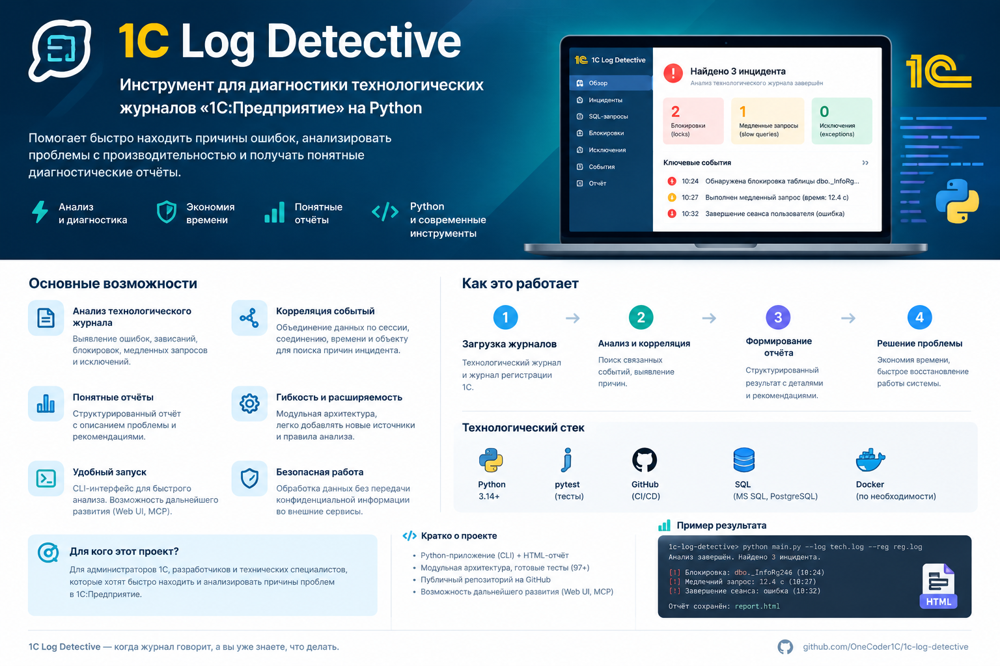

# 1C Log Detective



**1C Log Detective** — личный технический проект на Python для анализа технологических журналов 1С:Предприятие, исследования ошибок и подготовки диагностических отчётов.

Цель проекта — помочь разработчику быстрее находить значимые события в больших журналах, анализировать исключения и SQL-операции, а также исследовать возможные связи между блокировками и ошибками.

Проект развивается поэтапно. Основное внимание уделяется разбору событий, потоковой обработке данных, диагностике и автоматическому тестированию.

## Возможности

- **Разбор технологического журнала** — извлечение событий и их основных атрибутов.
- **Потоковая обработка** — обработка событий без необходимости загружать весь журнал в память.
- **Анализ SQL-событий** — исследование SQL-операций и связанных диагностических сведений.
- **Группировка исключений** — объединение ошибок по категориям и деталям.
- **Исследование блокировок** — поиск временных и контекстных связей между событиями блокировок и исключениями.
- **Диагностические отчёты** — формирование сводной информации о найденных событиях.
- **Автоматические тесты** — проверка основных модулей проекта.

> Важно: временная или контекстная близость событий сама по себе не доказывает причинно-следственную связь. Результаты анализа требуют проверки разработчиком.

## Технологии

- Python 3.14+
- pytest — автоматическое тестирование
- Git и GitHub — контроль версий и публикация проекта
- Технологический журнал 1С:Предприятие — источник диагностических данных

## Структура проекта

```text
1c-log-detective/
├── main.py
├── techlog.py
├── sql_analysis.py
├── exception_groups.py
├── lock_analysis.py
├── report.py
├── generate_report.py
├── sample_log.txt
├── banner.png
├── README.md
└── tests/
    ├── test_main.py
    ├── test_techlog.py
    ├── test_sql_analysis.py
    ├── test_exception_groups.py
    ├── test_lock_analysis.py
    └── test_report.py
```

## Запуск базового анализатора

Для демонстрации базового CLI-анализатора используется пример текстового журнала.

```powershell
python main.py sample_log.txt report.txt ALL
```

Параметры команды:

- `sample_log.txt` — входной текстовый файл.
- `report.txt` — файл для сохранения отчёта.
- `ALL` — фильтр событий.

Доступные фильтры базового анализатора: `ALL`, `ERROR`, `WARNING`, `CRITICAL`.

Пример предназначен для демонстрации базового сценария. Он не означает, что все модули анализа технологического журнала уже объединены в один CLI.

## Автоматические тесты

Установка pytest:

```powershell
python -m pip install pytest
```

Запуск тестов из корня проекта:

```powershell
python -m pytest -v
```

На этапе подготовки текущей версии успешно прошли **97 тестов**.

## План развития

- Объединение модулей анализа в единый сценарий запуска.
- Улучшение корреляции событий по времени, потоку и контексту.
- Расширение анализа SQL-событий, блокировок и исключений.
- Развитие диагностических отчётов.
- Подготовка безопасных обезличенных примеров для демонстрации возможностей.

## Статус проекта

Проект находится в активной разработке. Отдельные модули анализа уже реализованы и покрыты тестами, однако их интеграция в единый диагностический конвейер продолжается.

## Автор и исходный код

GitHub: [OneCoder1C/1c-log-detective](https://github.com/OneCoder1C/1c-log-detective)