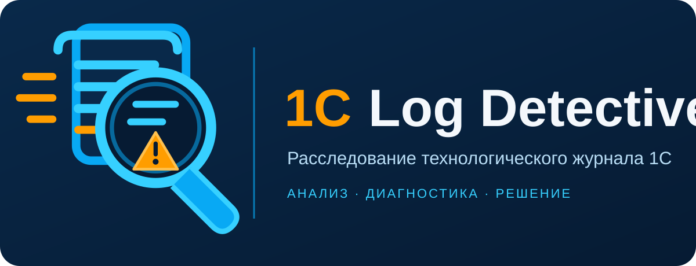

# 1C Log Detective



**1C Log Detective** — инструмент для анализа технологического журнала 1С:Предприятие 8.3. Помогает выявлять ошибки, исследовать блокировки, анализировать SQL-запросы и восстанавливать последовательность событий вокруг инцидента.

Проект ориентирован на диагностику проблем производительности и поиск причин ошибок в информационных системах 1С.

## Возможности

- **Анализ технологического журнала** — потоковая обработка больших файлов без необходимости загружать весь журнал в оперативную память.
- **Поиск исключений (EXCP)** — выявление ошибок и анализ контекста их возникновения.
- **Анализ блокировок (TLOCK)** — исследование конфликтов блокировок и связанных событий.
- **Анализ SQL** — извлечение SQL-запросов, определение типов операций, таблиц и показателей выполнения.
- **Корреляция событий** — восстановление последовательности событий по пользователю, процессу, потоку и контексту.
- **Единый анализатор** — объединение результатов анализа различных типов событий.
- **Интерактивный HTML-отчёт** — просмотр инцидентов, хронологии, диагностических признаков и связанных событий.
- **Экспорт отчёта об ошибке** — формирование Markdown-файла с контекстом инцидента, хронологией, SQL, диагностическими признаками и рекомендациями.

## Демонстрация

Примеры результатов работы находятся в каталоге `demo`:

- [Интерактивный HTML-отчёт](demo/incident_report.html)
- [Текстовый отчёт анализа](demo/demo_report.md)
- [Пример технологического журнала](demo/sample_techlog.txt)

Демонстрационный журнал содержит синтетические данные.

## Требования

- Python 3.14
- Windows, Linux или macOS
- Git

## Установка

```powershell
git clone https://github.com/OneCoder1C/1c-log-detective.git
cd 1c-log-detective

python -m pip install -r requirements.txt
python -m pip install pytest
```

## Быстрый запуск

Запуск анализа демонстрационного журнала:

```powershell
python run_unified_analysis.py demo/sample_techlog.txt demo/demo_report.txt
```

Анализ собственного технологического журнала:

```powershell
python run_unified_analysis.py "путь\к\журналу.log"
```

С указанием файла результата:

```powershell
python run_unified_analysis.py "путь\к\журналу.log" "analysis_result.txt"
```

## Интерактивный HTML-отчёт

Формирование HTML-отчёта:

```powershell
python generate_html_report.py "путь\к\журналу.log" "reports\incident_report.html"
```

Отчёт позволяет:

- переключаться между обнаруженными инцидентами;
- просматривать сводку по выбранному инциденту;
- изучать хронологию событий до и после ошибки;
- переходить к событиям по временной шкале;
- просматривать связанные события других потоков;
- фильтровать события по типу и пользователю;
- выделять проблемные события;
- просматривать диагностические признаки и рекомендации;
- переключать тему оформления;
- экспортировать диагностический отчёт в Markdown.

## Дополнительный анализ

Анализ событий конкретного пользователя:

```powershell
python main.py "путь\к\журналу.log" USER "Имя пользователя"
```

Базовый построчный анализ текстового файла:

```powershell
python main.py sample_log.txt report.txt ALL
```

Доступные фильтры: `ALL`, `ERROR`, `WARNING`, `CRITICAL`.

Этот режим отличается от полноценного анализа технологического журнала 1С.

## Производительность

Проект проверялся на реальном технологическом журнале объёмом около 7,45 ГБ.

| Показатель | Результат |
|---|---:|
| Размер журнала | 7,45 ГБ |
| Количество событий | 3 126 347 |
| События TLOCK | 231 724 |
| Исключения блокировок | 205 |
| Время анализа | 16 мин 46 сек |
| Пиковое потребление памяти | 397,46 МБ |
| Память после анализа | 36,99 МБ |

Результаты относятся к конкретному запуску и зависят от оборудования, настроек и состава технологического журнала.

## Тестирование

Для запуска автоматических тестов:

```powershell
python -m pytest -v
```

Последний полный результат:

```text
288 passed
```

В GitHub Actions настроен автоматический запуск тестов на Python 3.14.

## Технологии

- Python
- SQLite
- SQL
- HTML / CSS / JavaScript
- pytest
- GitHub Actions

## Ограничения

- Качество диагностики зависит от состава и полноты технологического журнала.
- Корреляция событий не всегда позволяет однозначно установить первопричину проблемы.
- Выводы анализатора следует рассматривать как диагностические гипотезы, требующие проверки.

## Планы развития

- Улучшение корреляции событий блокировок.
- Развитие анализа SQL и связей между событиями.
- Улучшение определения вероятной причины инцидента.
- Расширение